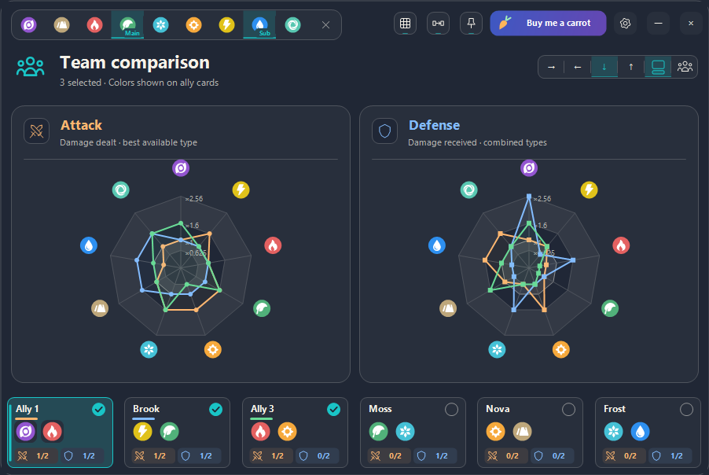

# Affinisaur

Unofficial Aniimo companion by Lapinosaur. Formerly Aniimo Affinities.

The repository URL, executable asset name `AniimoAffinities.exe` and local preference folder keep their existing names for update and settings compatibility.

A compact Windows companion for exploring Aniimo type matchups, by **Lapinosaur**.



## Features

- Select one or two types and explore their attack and defense affinities.
- Switch between affinity diagrams, a color-coded effectiveness matrix and radar charts.
- Pin the app or hold to lock a minimal overlay, with dedicated move and resize controls.
- Customize keyboard shortcuts, appearance, text size, window scale and keyboard badges.
- Use Ctrl + Up / Ctrl + Down to resize from 50% to 150% in 25% steps.
- Plan two teams of six, preview a member on hover and click to keep the selection.
- Place the team panel beside, above or below the main view.
- Replay selected tutorial sections or resume an unfinished tour from Settings.
- Settings and committed selections are remembered locally.

## Run

Windows x64 with .NET Framework 4.x (included in current Windows 10/11).
Download `AniimoAffinities.exe` from the repository release and run it. No installer, server or WebView is required. The executable is not code-signed.

The app does not perform screen capture or recognition. Preferences are stored in `%LOCALAPPDATA%/AniimoAffinities`. External links open a browser only when clicked. The app checks GitHub for a newer stable release after startup; downloads require confirmation. Verified updates install on the next launch of the same executable, with the previous executable saved as `.previous`. About & Credits offers a manual update check; Tutorial & Help groups Discord support, diagnostics and local storage. The tutorial opt-out is stored outside the executable and survives updates. Each stable release must include `AniimoAffinities.exe` and `SHA256SUMS.txt`.

## Community

[Join the Lapinosaur Discord community](https://discord.gg/qdsWumFaZz) for updates, feedback and support. This invitation never expires, has no usage limit and assigns the **Member** and **GitHub** roles when you join.

## Build and develop

Install Node.js 22 or later on Windows, then run:

```powershell
npm run check
npm run build
npm run preview -- radar-separate
```

No npm dependencies are required. The canonical build uses the Windows .NET Framework compiler. The runtime is written to `dist/AniimoAffinities.exe`; tests and preview tools are compiled separately and use isolated temporary preferences. `node build.mjs` remains a build-and-test shortcut.

See [CONTRIBUTING.md](CONTRIBUTING.md) for commands and IDE setup, and [the architecture guide](docs/architecture.md) for ownership and dependency rules.

```text
src/       Application, domain, data, infrastructure and UI
assets/    Type icons and branding
data/     Versioned matchup projections
tests/    Behavior regression suites
tools/    Isolated diagnostics and previews
scripts/  Build and architecture checks
docs/     Architecture and screenshots
```

## Data and credits

The checked-in `types.txt`, `matchups.txt` and `matrix-emphasis.txt` are the build-time projections used by the native app, exported from the internal Aniimo matchup and ranking models. Attack uses the best available single attack; defense multiplies the selected defender type factors. These files make this standalone snapshot buildable without the parent project.

Type icons originate from [ManuelGraf/AniimoWeaknessCalculator](https://github.com/ManuelGraf/AniimoWeaknessCalculator/blob/main/src/aniimo-icons.svg). They are community traces of game artwork. The source repository did not declare a license when retrieved; redistribution rights have not been established. No license grant for these third-party assets is implied.

Unofficial fan tool, not affiliated with or endorsed by Aniimo or its rights holders.

## License

The in-app **Legal & Privacy** page renders the bundled [legal document](docs/legal.md) offline, with headings, paragraphs, links and vertical scrolling. Edit that Markdown file to maintain its content. It includes terms of use, privacy information, publisher contact and third-party rights, with outstanding legal details explicitly identified.

Original code, scripts and documentation are licensed under [MIT](LICENSE), copyright 2026 Lapinosaur. Third-party assets and game content are not relicensed: see [resource rights and notices](THIRD_PARTY_NOTICES.md). The bundled artwork review remains unresolved.

## Code signing policy

Releases are currently unsigned. See the [code signing policy and preparation](docs/code-signing.md) and [privacy and removal information](docs/privacy.md). The [SignPath application](docs/signpath-application.md) was submitted on 22 October 2026 and is awaiting review. No certificate or sponsorship has been granted.

See [1.0 readiness](docs/1.0-readiness.md) for remaining manual acceptance checks and the CI publication procedure.
