# Affinisaur

Unofficial Aniimo companion by Lapinosaur. Formerly Aniimo Affinities.

The executable is named `Affinisaur.exe`. The repository URL and local preference folder keep their existing names. Releases from v0.6.0 also provide an identical `AniimoAffinities.exe` compatibility asset for older update clients; existing installations keep their chosen file path when updating.

A compact Windows companion for exploring Aniimo type matchups, by **Lapinosaur**.


## Features

See [what changed in v0.8.0](docs/releases/v0.8.0.md), including interactive suggestion bubbles, radar previews and animated tutorials.

- Select one or two types and explore their attack and defense affinities.
- Switch between affinity diagrams, a color-coded effectiveness matrix and radar charts.
- Pin the app or hold to lock a minimal overlay, with dedicated move and resize controls.
- Customize keyboard shortcuts, appearance, text size, window scale and keyboard badges.
- Use Ctrl + Up / Ctrl + Down to resize from 50% to 150% in 25% steps.
- Plan two teams of six, preview a member on hover and click to keep the selection.
- Place the team panel beside, above or below the main view.
- Fill empty ally slots with complementary mono/dual-type suggestions. **Suggested coverage** builds general coverage; **Suggested counter** responds to known opposing members. Further suggestions add backup answers after initial coverage is complete.
- Inspect graphical suggestion explanations: opposing type icons, attack/defense multipliers and projected answer counts. Gray proposed types become colored when applied.
- Check allies to compare their colored traces on the main Attack and Defense radars, with matching legends on their cards and a shared dynamic scale.
- Inspect single-type, dual-type and member threat reports, with readable multipliers and individual matchup tooltips.
- Lock the overlay for frosted surfaces with sharp foreground content and transparent gaps. Inactive ally actions are hidden while locked.
- Play, resume or replay compact individual tutorials, or launch all / unfinished tutorials. Animated demos use real controls without changing your team or settings; clickable progress points keep completion independent of navigation.
- Preview Dark, System and Light themes and three independent frosted-glass options in Display. Hover is temporary; Apply commits. Main-window glass previews target the parent window.
- Keep ordinary timed tooltips distinct from interactive suggestion bubbles: move into a bubble to use its controls, close it with the cross or leave its hover area.
- Inspect complete matchup lists in scrollable hover bubbles, with a close button and no countdown.
- Read consistent keyboard-key badges in tooltips and tutorials.
- Settings and committed selections are remembered locally.

## Team planning in practice

Suggestions are planned in slot order. Their **before** counts include both applied allies and earlier unapplied proposals. The explanation lists these separately and shows the earlier proposals in gray. Applying one slot does not apply the others; it recalculates the remaining suggestions. Coverage is a type-based heuristic, not a guarantee of an optimal team: it does not use species, moves or combat statistics.

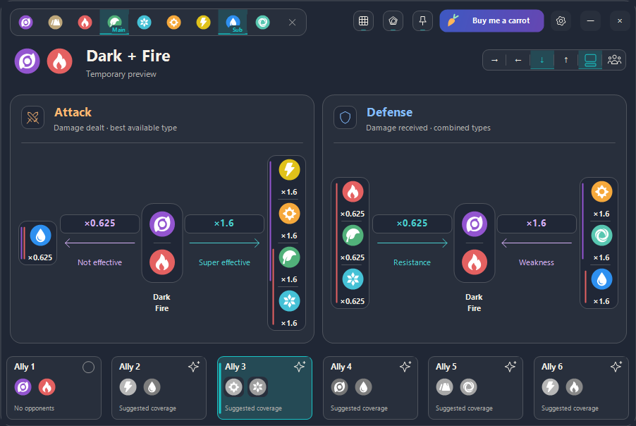

Select several ally checkboxes to compare them on the main radars. Clicking a card selects its ordinary affinity view; checking its box controls comparison independently. Comparison checks are session-only and do not populate the separate radar window.

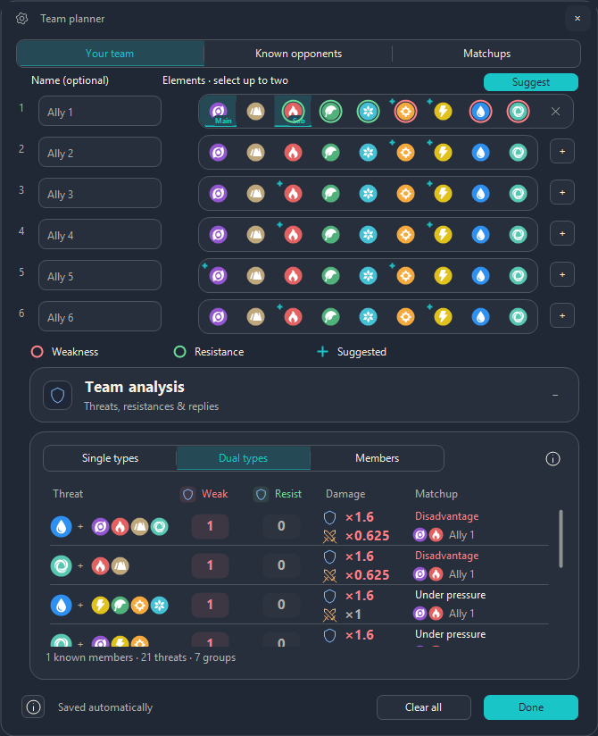

Existing users, including v0.7.0 users, receive a new three-step, skippable **What's new** tour once for v0.8.0, even if they previously hid the introductory tutorial. Skip/Esc prevents automatic reopening; Help & Tutorial lets you resume or replay it. Existing completion history is retained. New installations follow the updated introductory tutorials.

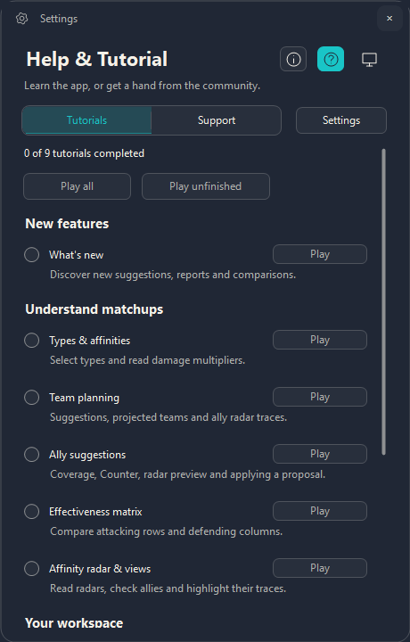

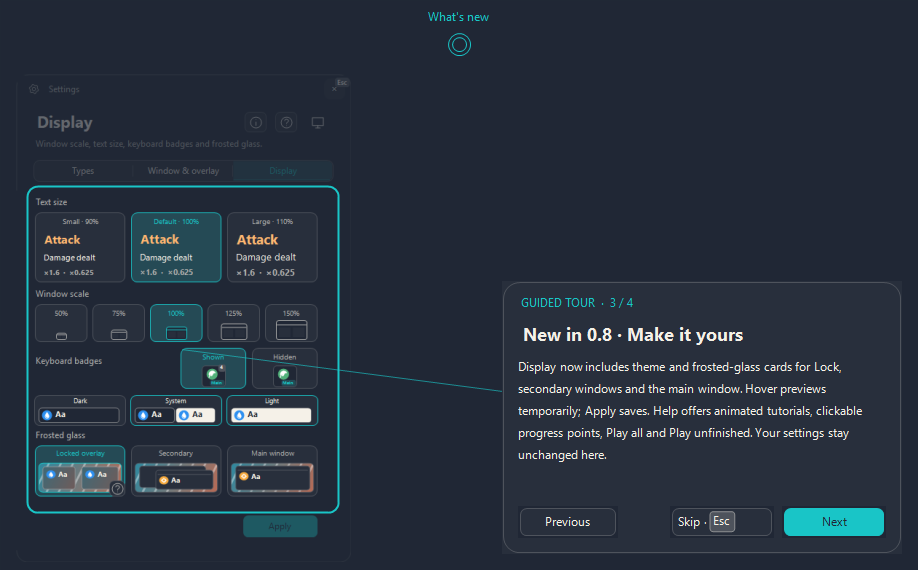

## Inspect before applying

Suggestion bubbles include **Radar preview** and **Apply suggestion**. The top-right open button opens a persistent window with one tab per suggested ally and the current suggestion selected. Type icons remain visible in each tab.

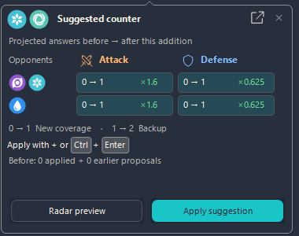

Compare the proposed ally with your team, hover a legend to emphasize one trace, then apply directly from the radar preview. Applying recalculates remaining proposals. Main-radar traces also highlight when you hover a checked ally card.

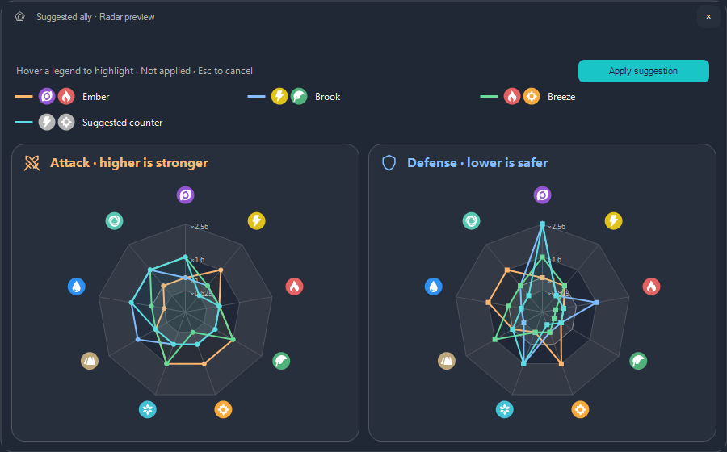

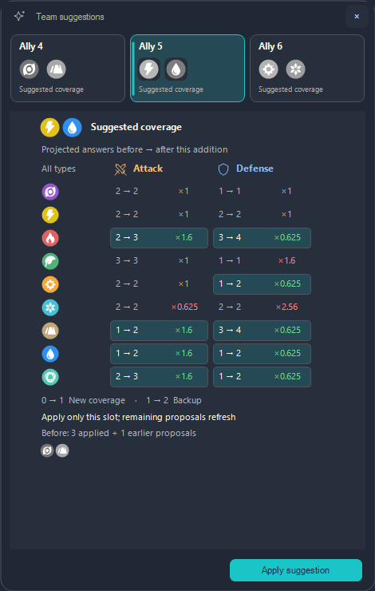

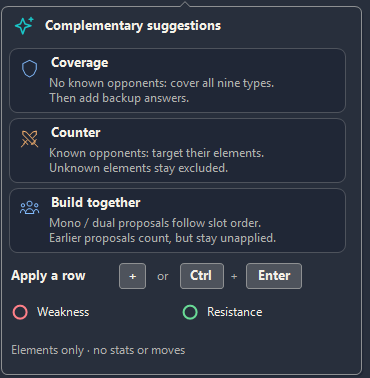

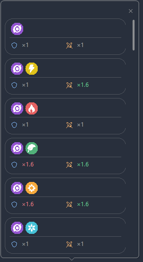

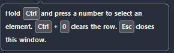

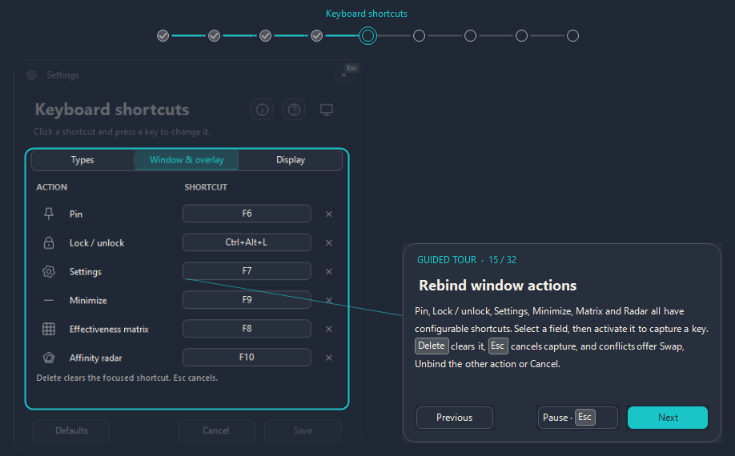

## Preview your display

Display combines text size, window scale, keyboard badges, theme and glass previews. Glass can be enabled separately for the locked overlay, secondary windows and the main window. A slightly stronger translucent veil and more contrasted secondary labels improve readability while keeping the background visible. Hover previews restore on exit without saving; use Apply to commit. The lock preview links to the animated pin/hold tutorial.

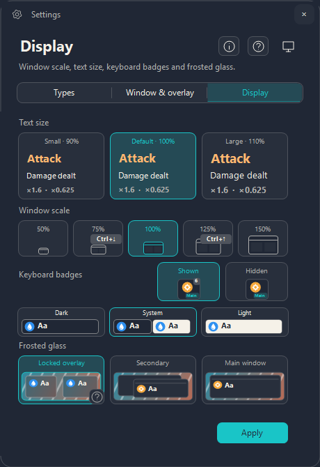


## Run

Windows x64 with .NET Framework 4.x (included in current Windows 10/11).
Download [Affinisaur.exe](https://github.com/Lapinosaur/aniimo-affinities/releases/latest/download/Affinisaur.exe) and run it. The `AniimoAffinities.exe` asset is an identical compatibility copy for older updaters. No installer, server or WebView is required. The executable is not code-signed.

The app does not perform screen capture or recognition. Preferences are stored in `%LOCALAPPDATA%/AniimoAffinities`. External links open a browser only when clicked. The app checks GitHub for a newer stable release after startup; downloads require confirmation. Verified updates install on the next launch of the same executable, with the previous executable saved as `.previous`. About & Credits offers a manual update check; Tutorial & Help groups Discord support, diagnostics and local storage. The tutorial opt-out is stored outside the executable and survives updates. New stable releases must include `Affinisaur.exe`, the identical compatibility asset `AniimoAffinities.exe`, and `SHA256SUMS.txt` covering both names.

## Community

[Join the Lapinosaur Discord community](https://discord.gg/qdsWumFaZz) for updates, feedback and support. This invitation never expires, has no usage limit and assigns the **Member** and **GitHub** roles when you join.

## Build and develop

Install Node.js 24.22.1 LTS or later on Windows, then run:

```powershell
npm run check
npm run build
npm run preview -- radar-separate
```

No npm dependencies are required. The canonical build uses the Windows .NET Framework compiler. The runtime is written to `dist/Affinisaur.exe`; tests and preview tools are compiled separately and use isolated temporary preferences. `node build.mjs` remains a build-and-test shortcut.

See [CONTRIBUTING.md](CONTRIBUTING.md) for commands and IDE setup, and [the architecture guide](docs/architecture.md) for ownership and dependency rules.

```text
src/       Application, domain, data, infrastructure and UI
assets/    Type icons and branding
data/     Versioned matchup projections
tests/    Behavior regression suites
tools/    Isolated diagnostics and previews
scripts/  Build and architecture checks
docs/     Architecture and screenshots
```

## Data and credits

The checked-in `types.txt`, `matchups.txt` and `matrix-emphasis.txt` are the build-time projections used by the native app, exported from the internal Aniimo matchup and ranking models. Attack uses the best available single attack; defense multiplies the selected defender type factors. These files make this standalone snapshot buildable without the parent project.

Type icons originate from [ManuelGraf/AniimoWeaknessCalculator](https://github.com/ManuelGraf/AniimoWeaknessCalculator/blob/main/src/aniimo-icons.svg). They are community traces of game artwork. The source repository did not declare a license when retrieved; redistribution rights have not been established. No license grant for these third-party assets is implied.

Unofficial fan tool, not affiliated with or endorsed by Aniimo or its rights holders.

## License

The in-app **Legal & Privacy** page renders the bundled [legal document](docs/legal.md) offline, with headings, paragraphs, links and vertical scrolling. Edit that Markdown file to maintain its content. It includes terms of use, privacy information, publisher contact and third-party rights, with outstanding legal details explicitly identified.

Original code, scripts and documentation are licensed under [MIT](LICENSE), copyright 2026 Lapinosaur. Third-party assets and game content are not relicensed: see [resource rights and notices](THIRD_PARTY_NOTICES.md). The bundled artwork review remains unresolved.

## Code signing policy

Releases are currently unsigned. See the [code signing policy and preparation](docs/code-signing.md) and [privacy and removal information](docs/privacy.md). The [SignPath application](docs/signpath-application.md) was submitted on 22 October 2026 and is awaiting review. No certificate or sponsorship has been granted.

See [1.0 readiness](docs/1.0-readiness.md) for remaining manual acceptance checks and the CI publication procedure.
