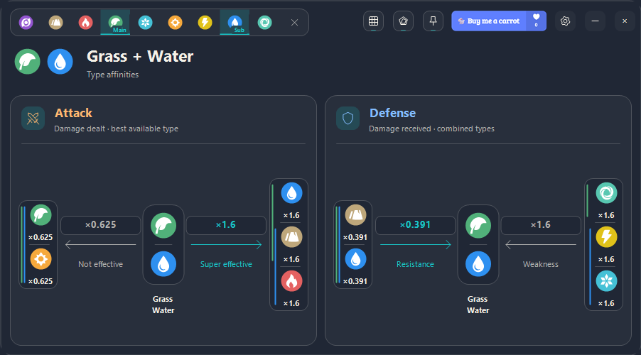

# Aniimo Affinities

A compact Windows companion for exploring Aniimo type matchups, by **Lapinosaur**.



## Features

- Select one or two types and explore their attack and defense affinities.
- Switch between affinity diagrams, a color-coded effectiveness matrix and radar charts.
- Pin the app or hold to lock a minimal overlay, with dedicated move and resize controls.
- Customize keyboard shortcuts, appearance, text size, window scale and keyboard badges.
- Use Ctrl + Up / Ctrl + Down to resize from 50% to 150% in 25% steps.
- Follow the guided tutorial; replay it or disable startup guidance in Settings.
- Settings and committed selections are remembered locally.

## Run

Windows x64 with .NET Framework 4.x (included in current Windows 10/11).
Download `AniimoAffinities.exe` from the repository release and run it. No installer, server or WebView is required. The executable is not code-signed.

The app does not perform screen capture or recognition. Preferences are stored in `%LOCALAPPDATA%/AniimoAffinities`. The support button opens a browser only when clicked.

## Build and test

Install Node.js 22 or later on Windows, then run:

```powershell
node build.mjs
```

No npm dependencies are required. The build uses the Windows .NET Framework C# compiler and runs the embedded self-tests. Output: `dist/AniimoAffinities.exe` and `dist/tests.txt`.

```powershell
.\dist\AniimoAffinities.exe --self-test report.txt
.\dist\AniimoAffinities.exe --preview preview.png
```

This is an initial native prototype. Tests cover 81 type selections, vector resources, selection behavior, preference handling and keyboard capture. Display changes applied from Settings have a timed rollback confirmation.

## Data and credits

The checked-in `types.txt`, `matchups.txt` and `matrix-emphasis.txt` are the build-time projections used by the native app, exported from the SaveOverride Aniimo matchup and ranking models. Attack uses the best available single attack; defense multiplies the selected defender type factors. These files make this standalone snapshot buildable without the parent project.

Type icons originate from [ManuelGraf/AniimoWeaknessCalculator](https://github.com/ManuelGraf/AniimoWeaknessCalculator/blob/main/src/aniimo-icons.svg). They are community traces of game artwork. The source repository did not declare a license when retrieved; redistribution rights have not been established. No license grant for these third-party assets is implied.

Unofficial fan tool, not affiliated with or endorsed by Aniimo or its rights holders. No blanket open-source license has been assigned to this initial publication.
